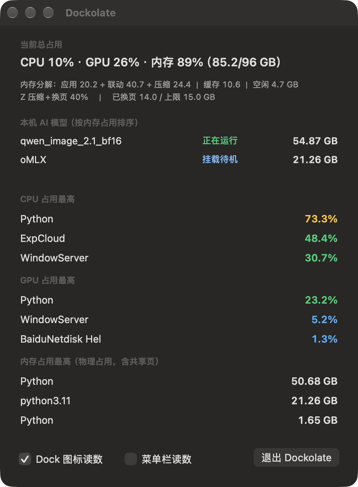

# Dockolate

[](https://github.com/autugit/dockolate/releases/latest)
[](https://autugit.github.io/dockolate/)
[](LICENSE)
[](https://github.com/autugit/dockolate)
[](https://github.com/autugit/dockolate/stargazers)

**Dock 里的一板巧克力** —— 用四格水位实时显示 CPU / GPU / 内存压力，外加一份「内存里现在真挂着哪些本地 AI 模型」的清单。

<p align="center">
  
  
</p>


图标是 2×2 四宫格，每格一个字母水印 + 从底部升起的水位，高低和颜色一眼看出紧迫程度：

```
┌────────┬────────┐
│   C    │   G    │   C = CPU      G = GPU
│  ▓▓░░  │  ▓░░░  │   （蓝色水位 = 极低）
├────────┼────────┤
│   M    │   Z    │   M = 内存     Z = 压缩+换页
│  ▓▓▓░  │  ▓▓▓▓  │   （绿/黄/红随水位升高）
└────────┴────────┘
```

水位配色：**< 20% 蓝 · 20–50% 绿 · 50–80% 黄 · ≥ 80% 红**

- 图标里**不放数字**——数字会跟字母抢地方，而且 Dock 尺寸下也读不准；精确值去窗口看。
- 点 Dock 图标 → 弹出窗口：
  - **本机 AI 模型**：内存里挂着的本地模型（oMLX / llama.cpp / ComfyUI / Draw Things …），
    按内存占用从大到小排，逐行标 **正在运行 / 挂载待机 / 出现故障**；声明了但没加载的列在脚注里；
  - **CPU / GPU / 内存占用最高的各三个进程**，外加内存分解（应用/联动/压缩/缓存/空闲）与换页量。
- 菜单栏读数默认关闭，窗口里的「菜单栏读数」按钮可随时打开。

### Z 是什么

**Z = 内存压缩 + 换页水位** = (压缩内存 + 已换页) ÷ 物理内存。
它和 M 是两个维度：M 看「用了多少」，Z 看「被挤压了多少」——
Z 越高说明系统为了腾地方压得越狠、换出去的越多，内存越紧张。

## 两个显示面，各自可开关

窗口左下角：**「Dock 图标读数」** 与 **「菜单栏读数」** 两个独立勾选框，选择记进 `UserDefaults`，下次启动沿用。

| Dock 图标 | 菜单栏 | 效果 |
|---|---|---|
| 勾 | 不勾 | 只有 Dock 水位四宫格（默认） |
| 不勾 | 勾 | 菜单栏紧凑读数 `C12 G40 M63`（字母按占用率变色） |
| 勾 | 勾 | 两个都要 |
| 不勾 | 不勾 | 只留窗口，不画任何常驻读数 |

## 支持哪些本地引擎（通用探测，不依赖任何一家私有网关）

**端口是探测出来的，不是写死的。** 先看被识别为模型服务的进程实际监听了哪些端口，
所以你把服务挪到自定义端口照样认得出；内置的一张小默认表只在「进程认不出来」时兜底，
其余可以在 `engines.json` 里补。下面这张表列的是**询问方式**，不是端口要求。

| 引擎 | 模型名怎么来 |
|---|---|
| Ollama | `GET /api/ps`（在跑）+ `GET /api/tags`（已下载 → 未加载清单） |
| LM Studio | `GET /api/v0/models` 的 `state == "loaded"` |
| llama.cpp `llama-server` | `GET /v1/models`，取不到再从 `--model` 参数抠 |
| vLLM / MLX / oMLX | `GET /v1/models` |
| ComfyUI | `GET /queue` → `GET /history` 的 `ckpt_name` / `unet_name` |
| A1111 / Forge / Draw Things | `GET /sdapi/v1/options` 的 `sd_model_checkpoint` |
| Fooocus / InvokeAI / KoboldCpp / text-generation-webui | `GET /v1/models` |
| 应用内模型（Draw Things、LM Studio 桌面版） | 进程指纹 + `phys_footprint` |

状态口径：**正在运行** = 端口在应答且最近 12 秒内真算过东西（CPU 或 GPU 时间在涨）；
**挂载待机** = 权重在内存、端口在应答、没在算；**出现故障** = 进程占着端口但端口不应答；
**未加载** = 已下载未常驻（只有 Ollama / LM Studio 提供这个信息），单独列出、不占内存。

需要鉴权的引擎（比如 oMLX 无 key 一律 401）拿不到模型名时只显示引擎名 + 端口，不猜。
配置 `~/Library/Application Support/Dockolate/engines.json`：

```json
{ "extraPorts": [12345], "apiKeys": { "12345": "sk-your-key" } }
```

也支持环境变量 `DOCKOLATE_KEY_<端口>` 或 `DOCKOLATE_KEY`。

## 安装

```bash
./install.sh
```

会编译、装到 `~/Applications/Dockolate.app`，并注册 LaunchAgent（登录自启 + 崩溃 4 秒内自拉起）。

## 卸载

```bash
./uninstall.sh
```

## 只编译不安装

```bash
./build.sh          # 产物：build/Dockolate.app
```

## 自检 / 验收（无需屏幕录制权限）

```bash
BIN=./build/Dockolate.app/Contents/MacOS/Dockolate

$BIN --dump --out=/tmp                        # 采样一次并导出图标 PNG
$BIN --dump --verbose --out=/tmp              # 附带内存去向与 Z 的分解
$BIN --dump --mock=8,16,35,88 --out=/tmp      # 强制 C/G/M/Z 四个水位，验四种颜色
$BIN --procs                                  # 打印三个进程榜（窗口的数据源）
```

## 数据口径

| 指标 | 来源 | 口径 |
|---|---|---|
| CPU | `host_processor_info(PROCESSOR_CPU_LOAD_INFO)` | 两次采样间全核 busy/total 增量比 |
| GPU | `ioreg -c AGXDeviceUserClient` → Σ`accumulatedGPUTime` 增量 | 所有客户端 GPU 时间增量 ÷ 墙钟（**不要用 `Device Utilization %`，它会假报 0**） |
| 内存 | `host_statistics64(HOST_VM_INFO64)` | (internal 匿名页 + wired + 压缩器) / 总物理内存（**不要用 active_count，它混着几十 GB 文件缓存**） |
| Z 压缩+换页 | `sysctl vm.swapusage` + 压缩器页数 | (压缩内存 + 已换页) / 总物理内存 |
| 进程 CPU | `ps -r` 按 `%CPU` 降序 | 取前三 |
| 进程 GPU | `ioreg -c AGXDeviceUserClient` → `AppUsage.accumulatedGPUTime` 差 | 该客户端累计 GPU 时间（ns）增量 ÷ 墙钟 = 占整颗 GPU 的百分比 |
| 进程内存 | `proc_pid_rusage` → `ri_phys_footprint`（libproc） | 物理占用，与活动监视器同口径（**别用 `ps` 的 rss，对 mmap 大户会少报 23 倍**） |

> 进程 GPU 是这套工具的硬货：macOS 不提供公开的按进程 GPU 统计（`powermetrics` 要 root），
> 这里靠 IOKit 的 `AGXDeviceUserClient` 拿到，实测与设备总利用率吻合（压测进程 87.4% vs 设备 85–89%）。

采样节奏：CPU/内存 1 秒、GPU 2 秒；显示按 0.5 秒插值平滑；
图标只在**整数百分比**变化时重绘（小数抖动肉眼不可见，重绘纯属浪费）。
进程榜只在窗口打开时采样，窗口关闭即停。
实测自身开销约 **0.7% CPU / 93 MB**。

详见 `docs/开发文档.md`。

## 常见问题

**Mac 上不装 `sudo` 怎么看 GPU 占用？**
不调 `powermetrics`，而是从 `ioreg` 里遍历每个 `AGXDeviceUserClient` 的
`accumulatedGPUTime` 求和，所以永远不会弹密码框。总 GPU 占用在 Dock 图标上，
按进程的前三名在窗口里。

**怎么知道本机现在内存里挂着哪些本地 AI 模型？**
打开窗口。每个认出来的模型服务都会列出它实际占的内存
（`ri_phys_footprint`，与活动监视器同口径），并标 `running` / `loaded-idle` /
`failed`；Ollama、LM Studio 里下载了但没加载的也会单独列出。

**这是菜单栏应用还是 Dock 应用？**
都是，各自独立：Dock 图标是水位（默认开）；菜单栏文字读数（紧凑的
`C12 G40 M63`）是一个可选勾选框。两个都关就只剩窗口。

**Apple Silicon 还是 Intel？**
构建目标是 `arm64-apple-macosx13.0`。Intel 机器把 `build.sh` 里这一个目标改成
`x86_64-apple-macosx13.0` 即可，别处没有架构相关代码。

**需要 root、管理员权限或屏幕录制权限吗？**
都不需要。数据全来自公开 API —— `host_statistics64`、
`host_processor_info`、`proc_pid_rusage`、`proc_pidinfo`、`ioreg`。
没有特权守护进程，没有 entitlement，也不会弹权限申请。

**数据会离开本机吗？**
不会。HTTP 只发往 `127.0.0.1`；没有遥测，也没有更新检查。

**自定义端口的模型服务没被认出来。**
端口是从「认出来的进程实际监听的端口」反推的。进程认不出来时，可在
`~/Library/Application Support/Dockolate/engines.json` 里显式声明
`{"extraPorts": [12345]}`。

**和 iStat Menus、Stats、活动监视器有什么区别？**
那三个报在菜单栏或窗口里。Dockolate 的前提是 Dock 始终在眼前，四格水位隔着房间
就能回答「这台机器现在有没有压力」；而且它是这几个里唯一会把内存中常驻的本地
AI 模型清点出来的。

**为什么叫 Dockolate？**
它住在 Dock 里，2×2 的图标看着像一板掰开的巧克力。

## 作者

由 **Autumemory** 与 **Hermes**（agent）、**DeepSeek v4.1 flash**（模型）共同完成。
设计取舍、代码、实测数据与这些文档都出自这次协作。

## 许可

MIT，见 [LICENSE](LICENSE)。
